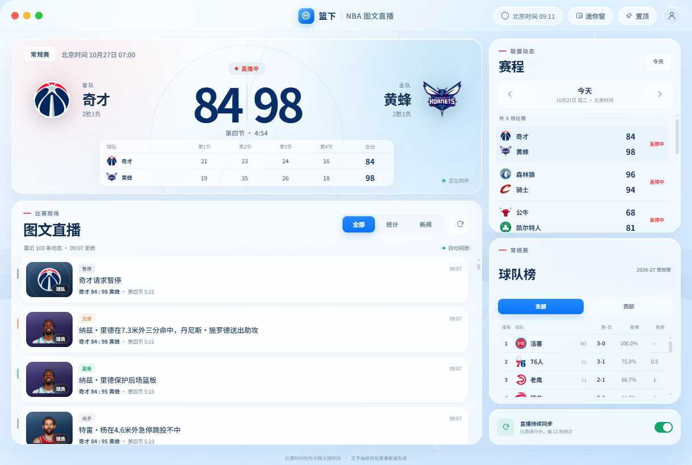
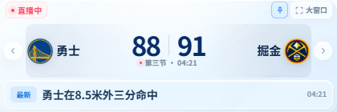

# 篮下 NBA 图文直播

一款苹果风格、全中文、按中国大陆时间显示的 Windows 桌面 NBA 图文直播应用。





## 功能

- 使用蓝橙渐变篮球、环绕光带与透明圆角底板组成的全新应用图标
- 冰蓝色球场视觉、玻璃质感卡片和更清晰的深海军蓝实时比分
- 实时比分、比赛状态、当前节次倒计时，以及按球队展示的内嵌分节比分表
- 分节比分表强化队徽和中文队名显示，单节与总分数字采用更轻巧紧凑的字号
- 中文图文直播，单条正文最多 2 行，并附 1 行比分与节次信息；
  单场最多保留 100 条动态，大窗口可同时浏览约 4 至 5 条
- `全部 / 统计 / 新闻` 三个视图：全部展示完整图文直播，统计展示实时球员
  数据，新闻将比赛双方近期报道整理为中文简报，优先展示球队相关的快讯、
  前瞻、战报与集锦，并标注发布时间
- 实时球员数据支持主客队切换，展示上场时间最多的 8 名球员，并列出时间、
  得分、篮板、助攻、抢断、盖帽、投篮、三分、罚球、失误、犯规和正负值
- 统计页球队切换卡片不再重复显示比分，球员头像采用 160 x 160 高清源图，
  头像和中文姓名在常规及最小窗口下均保持更大、更清晰的显示
- 赛程下方提供东西部常规赛球队榜，可切换查看战绩、胜率和胜差
- 点击任意一场比赛可在主窗口中切换当前场次
- 主窗口和迷你窗均提供切换按钮，同一时间只显示一个窗口；迷你窗标题栏
  可直接用左右箭头循环切换当天比赛，也可按键盘左右方向键切换
- 迷你窗采用参考横向比赛卡片的 420 x 140 布局，左右箭头切换比赛，
  中部展示双方中文队名、队徽、大比分和节次时间，底部仅保留最新一条
  中文文字直播
- 迷你窗支持 QQ 式顶部停靠：拖到屏幕顶部松开后自动收起，鼠标移回
  屏幕顶部对应区域时会平滑滑出，鼠标离开后立即自动收起；其他应用
  保持前台时也可在顶部悬停唤出且不会抢走焦点。收起后需先移开鼠标
  再返回顶部，避免窗口因指针仍停在顶部而反复弹出
- 迷你窗标题栏提供“固定”按钮，可随时切换窗口是否固定在最上层
- 按中国大陆日期查看赛程，可切换前后比赛日
- 北京时间、中文球队名、中文球员名和中文比赛事件描述
- 比赛进行中每 3 秒同步比分和文字直播，其他时段每 60 秒检查一次；
  当天全部比赛结束后停止赛程、比分、球员数据和文字直播轮询，仅每
  60 秒同步当前比赛双方的球队新闻
- 迷你窗只显示当前场次；当前比赛结束后停止赛况轮询，切换到其他比赛
  时会重新加载对应的实时比分和文字直播
- 自动刷新开关、手动刷新和 ESPN 高光缩略图
- 苹果风格无边框磨砂窗口，外围不再保留额外方框或透明边距，并提供
  红黄绿窗口按钮、置顶和最大化
- 最小支持 980 x 680 窗口尺寸

## 运行

开发运行需要 Node.js 22.12 或更高版本。

```powershell
cd outputs\NBA-Live
$env:ELECTRON_MIRROR = "https://npmmirror.com/mirrors/electron/"
npm install
npm start
```

如果已经安装依赖，直接运行：

```powershell
npm start
```

## 打包

```powershell
$env:ELECTRON_MIRROR = "https://npmmirror.com/mirrors/electron/"
npm run dist
```

安装包和便携版会输出到 `release/`。

## 数据与中文处理

- 比分、赛程、东西部排名、文字事件、双方新闻和高光缩略图来自 ESPN
  公开站点接口。
- 应用会同时读取中国大陆日期前一天、当天和后一天的数据，再按
  `Asia/Shanghai` 时区过滤，避免美国比赛日与北京日期错位。
- 图文内容不是直接翻译英文解说，而是根据事件类型、球员、得分、犯规、
  篮板、失误、暂停、换人和回看等结构化字段生成中文描述。
- 中文球员译名来自本地映射；遇到未收录球员时使用中文球队名和号码回退，
  不会在主界面直接显示英文球员名。
- 新闻原始标题为英文，界面会按球队、球员、比分、战绩和常见新闻类型生成
  中文标题与两行简报；不直接显示英文原题。

## 目录

```text
src/main.js          Electron 主进程、数据请求和窗口控制
src/preload.js       安全的渲染进程桥接
src/index.html       界面结构
src/styles.css       苹果风格视觉与响应式布局
src/app.js           北京时间、中文转换、直播和交互逻辑
src/mini.html        比赛速览迷你窗结构
src/mini.css         迷你窗苹果风紧凑布局
src/mini.js          迷你窗比分和文字直播逻辑
src/player-names.js  中文球员译名映射
build/icon.png       透明圆角的 Windows 应用图标
work/prepare-logo.py 清理透明边角并生成 Windows 图标
```

大尺寸 Logo 原图、SVG 封装和中间预览未纳入 Git 仓库。需要修改图标时，
运行 `python work/prepare-logo.py <Logo原图路径>` 重新生成 `build/icon.png`。

## 已知限制

- 必须联网使用，首次启动和切换比赛日时需要等待数据请求完成。
- ESPN 接口是公开但非官方接口，可能调整、限流或短暂不可用。
- 上游接口没有提供中文直播解说，本应用生成的是结构化中文赛况描述。
- 图文直播的刷新速度取决于上游数据更新，不等同于电视或官方文字直播。
- 当前安装包未配置商业代码签名，Windows SmartScreen 可能显示未知发布者提示。
- 本项目与 NBA、ESPN、虎扑均无隶属或官方授权关系。

更多第三方说明见 [THIRD_PARTY_NOTICES.md](./THIRD_PARTY_NOTICES.md)。
